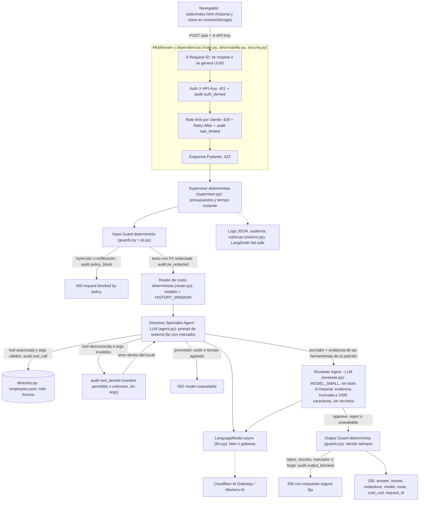
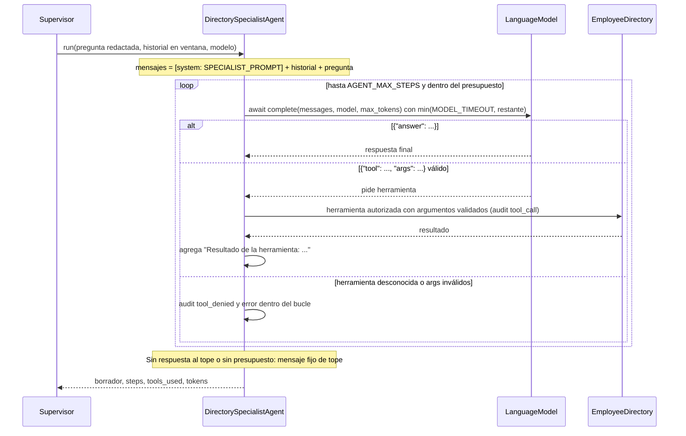

# Arquitectura del HR Assistant v1 (runtime)

Asistente de Recursos Humanos que responde preguntas sobre empleados sintéticos. Una API
FastAPI sin estado sirve una página web y, en cada `POST /ask`, un supervisor determinista
coordina guardas deterministas y dos agentes LLM: el Directory Specialist (con dos
herramientas de solo lectura sobre `data/employees.json`) y el Reviewer.

Este documento describe el **runtime** (lo que atiende peticiones). La **fábrica** (agentes
de Claude Code que construyen el producto) es otra cosa y se documenta en
[factory.md](factory.md).

## Runtime: componentes y flujo de `POST /ask`

## Entrada del Reviewer

El Reviewer no usa herramientas ni historial. Recibe exactamente dos mensajes (`system` y
`user`), armados por `build_review_messages` en `reviewer.py` (F3, ADR 0004):

- la pregunta ya redactada (sin PII);
- el borrador del Specialist, truncado a 2000 caracteres;
- la evidencia: los resultados de las herramientas del directorio en esa petición,
  serializados en JSON y truncados a `MAX_EVIDENCE_CHARS` (1500 caracteres). Si no se
  consultó ninguna herramienta, se indica con un texto fijo.

No recibe el historial de la conversación, la configuración ni secretos: la evidencia sale
solo de las herramientas de directorio (datos sintéticos). Esta evidencia agrega tokens a su
llamada, lo que se refleja en las cifras de `evidence/evaluate-simulated.md`.

## Bucle del Directory Specialist

El prompt de sistema del Specialist (`SPECIALIST_PROMPT` en `agent.py`) describe el
protocolo JSON y las dos herramientas; está en español, no lleva secretos, configuración ni
datos del directorio, y no cuenta en `HISTORY_WINDOW`. Su marcador (`SPECIALIST_MARKER`), igual
que el del Reviewer (`REVIEWER_MARKER`), hace que el Output Guard cambie la salida por la
respuesta segura si aparece.

## Decisiones de falla

| Situación | Resultado |
| --- | --- |
| Sin clave o clave inválida en `/ask` o `/metrics` | 401 `invalid or missing API key`; `request_id` solo en el encabezado |
| Rate limit excedido | 429 `rate limit exceeded` con `Retry-After` |
| Esquema, largo o número de mensajes inválidos | 422, sin llamar al modelo |
| Inyección o exfiltración | 400 `request blocked by policy` con `request_id` |
| Herramienta desconocida o argumentos inválidos | auditoría `tool_denied`; el bucle sigue dentro del tope |
| Proveedor caído en el Specialist | 502 `model unavailable` con `request_id` |
| Tiempo agotado en el Specialist (por llamada o por petición) | 502 `model unavailable`; no existe 504 |
| Presupuesto de llamadas o tokens agotado en el Specialist | 200 con el mensaje fijo de tope |
| Reviewer rechaza | 200 con respuesta segura fija; `review.status = rejected` |
| Reviewer caído, sin tiempo, sin presupuesto o con JSON inválido | 200 si pasa el Output Guard; `review.status = unavailable` |
| Error inesperado | 500 `internal error` con `request_id`; el log guarda solo el tipo |
| Fallo de telemetría | evento `telemetry_error` con el tipo; la respuesta no cambia |

Cada llamada al modelo usa `min(MODEL_TIMEOUT_SECONDS, tiempo restante de
REQUEST_TIMEOUT_SECONDS)`; si ya no queda tiempo, no se llama. Por eso el límite por
petición termina en 502 (Specialist) o `unavailable` (Reviewer), nunca en otro código.

## Principios

- Sin estado entre peticiones (ADR 0001); métricas y rate limiter son estado de instancia
  con lock, sin datos de peticiones.
- Modelo detrás de una interfaz con protocolo JSON (ADR 0002), ahora async (ADR 0004).
- Dependencias inyectadas en `create_app` y configuración validada al arrancar (ADR 0003).
- Solo dos agentes LLM; supervisor, guardas y router son deterministas (ADR 0004).
- PII redactada antes del proveedor, logs y trazas; el Output Guard decide siempre (ADR 0005).
- Routing de modelos como estrategia de costo; caché apagada; política de idioma (ADR 0006).
- La página pinta con `textContent`, nunca con `innerHTML`.
