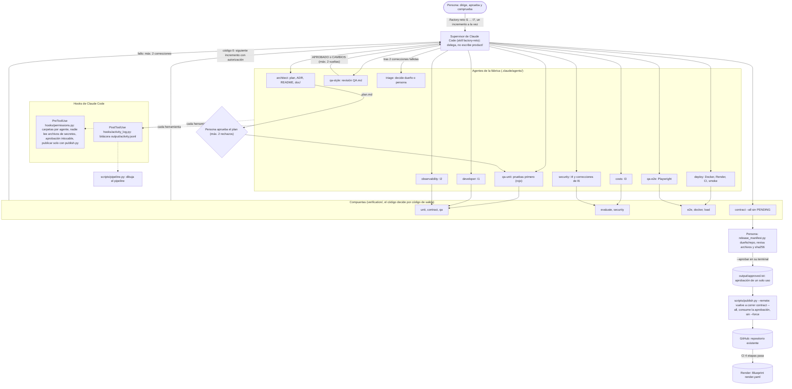

# La fábrica que construyó el HR Assistant v1

La **fábrica** es el conjunto de agentes de Claude Code que escribió el plan, las pruebas, el
código, la configuración y esta documentación. No atiende peticiones y no se despliega: vive
en el repositorio de trabajo (`.claude/agents/`, `.claude/skills/factory-reto/`, `hooks/`,
`verification/`, `scripts/`). El **runtime** (lo que atiende `POST /ask`) se describe en
[architecture.md](architecture.md); no hay que confundir sus agentes LLM (Directory
Specialist y Reviewer) con los agentes de la fábrica.

## Diagrama

## Piezas

| Pieza | Qué hace | Dónde |
| --- | --- | --- |
| Supervisor | Lanza a cada agente con el plan aprobado, corre las compuertas una por una y decide solo con códigos de salida y la primera línea de `output/qa-review.md` y `output/triage.md`. Nunca escribe en `product/`. | `.claude/skills/factory-reto/SKILL.md` |
| architect | Plan, ADR, `architecture.md`, `factory.md`, evidencia y README. | `.claude/agents/architect.md` |
| qa-unit | Escribe primero las pruebas Gherkin y unitarias; la suite debe quedar en rojo. | `.claude/agents/qa-unit.md` |
| developer, observability, costs, security | Un solo dueño de `product/app/` por incremento (I1 a I4). | `.claude/agents/` |
| deploy y qa-e2e | En paralelo en I5; ninguno toca `product/app/`. | `.claude/agents/` |
| qa-style | Revisa contra `QA.md` y escribe `output/qa-review.md` (`APROBADO` o `CAMBIOS`). | `.claude/agents/qa-style.md` |
| triage | Tras 2 correcciones fallidas, nombra al dueño o a `persona`; no corrige. | `.claude/agents/triage.md` |
| Hook de permisos | Bloquea (código 2) escrituras fuera de las carpetas de cada agente, cualquier lectura de archivos de entorno con secretos (solo las plantillas públicas quedan libres), todo toque de la aprobación, `git push` y `gh` directos, y `publish.py` encadenado o sin aprobación válida para su destino. Falla cerrado ante eventos malformados. | `hooks/permissions.py` |
| Bitácora | Una línea JSON por herramienta usada (quién, qué, resultado). | `hooks/activity_log.py`, `scripts/pipeline.py` |
| Compuertas | `uv run python -m verification <paso>`: 0 pasa, 3 es NOT RUN (nunca PASS), otro código falla. | `verification/` |
| Aprobación de publicación | La persona corre `release_manifest.py <dueño/repo>` (manifiesto con `sha256` por archivo y escaneo de secretos) y, si está de acuerdo, `--aprobar` en una terminal interactiva. `publish.py` valida destino, origen y `sha256` actuales, consume la aprobación una sola vez de forma atómica y nunca usa `--force`. | `scripts/release_manifest.py`, `scripts/publish.py` |

## Topes

- 2 rechazos del plan, 2 correcciones por compuerta y 2 vueltas de qa-style; después, triage
  o la persona.
- Ningún agente baja un umbral, borra una prueba ni convierte un fallo en omitida.
- Ningún commit, push, PR ni despliegue sin autorización explícita de la persona para ese
  paso.
